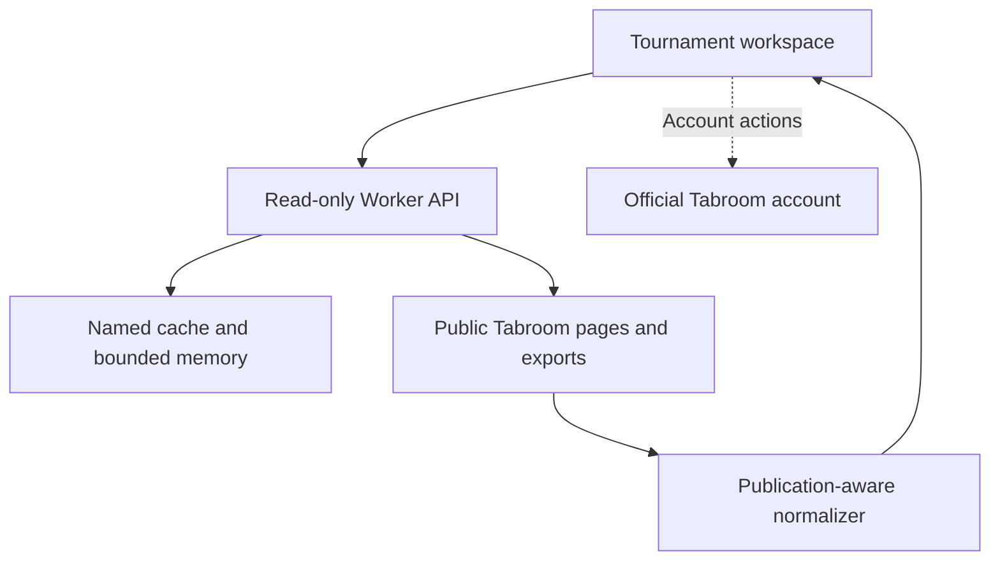

# Architecture

TabBetter is an independent, read-only view over public Tabroom information. It is not a tournament tabulation engine or an authenticated Tabroom client.

The normalizer whitelists output fields and rejects a private export or the wrong tournament ID. Unpublished results, contact fields, raw settings and private feedback are not copied into the interface. Account-only features open their official pages.

## Source layout

| Path                  | Responsibility                                                      |
| --------------------- | ------------------------------------------------------------------- |
| `web/index.html`      | Accessible page shell and navigation                                |
| `web/styles.css`      | Responsive layout and print styles                                  |
| `web/app.js`          | Routes, filtering, bookmarks and tournament views                   |
| `src/data.mjs`        | Calendar/circuit/invitation parsing and public export normalization |
| `src/server.mjs`      | Fixed upstream routes, validation, cache and response handling      |
| `scripts/compile.mjs` | Embed browser assets and logo into a self-contained Worker          |
| `scripts/build.sh`    | Produce `dist/server/index.js` and checkout-local hosting metadata  |
| `tests/`              | Synthetic publication-boundary and runtime failure cases            |
| `.github/workflows/`  | Repository checks, independent CodeQL analysis and Worker deploy       |
| `wrangler.toml`       | Worker name, entry artifact and production domain routes               |

## Automatic sync and rankings

An open tournament refreshes itself on the public-export cache cadence; see
[live sync](live-sync.md). Historical LD and PF ratings come from a separately
imported corpus embedded at build time; see
[competitor profiles](competitor-profiles.md) and
[rankings sources](rankings-sources.md). A build without that corpus reports
historical rankings as unavailable rather than inventing them.

## Cache and freshness

Calendar and invitation: 10 minutes. Public export: 5 minutes. Circuit directory: 1 hour. Named host caching is optional; a restricted host falls back to a bounded per-instance memory cache. Concurrent requests coalesce within an instance, not globally. A failed refresh may return a labeled warm-instance stale copy.

Every displayed dataset carries its source and retrieval timestamp. A public export with no pairings does not establish that a judge is unassigned. Multi-region coordination and a supported upstream integration remain launch work before large-scale public use.

## Build and deploy boundary

The build embeds assets so the Worker has no runtime package dependencies. Generated bundles and `.openai/` identity are ignored. Without a local production manifest, a neutral metadata file is generated only inside `dist/` for local validation.

The `Quality` and `Security` workflows validate source. The proposed `Deploy` workflow runs repository, parser, build, runtime and artifact checks before publishing `dist/server/index.js` to the `tabbetter` Cloudflare Worker. CodeQL remains a separate workflow. Production apex and `www` custom domains are live. Automatic deployment still requires PR #14 approval/merge and the API-token secret; see [Deployment](deployment.md).
