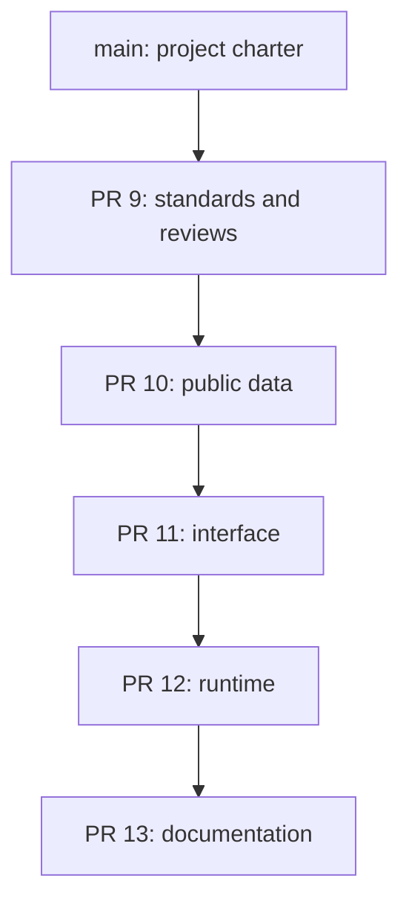

# Development and review workflow

## Initial review stack

This is a present-day import of an existing working prototype. Commits describe coherent source changes and real review fixes; they are not backdated and do not imply separate historical development sessions.



| Stage                              | Issue | PR  | Base branch             |
| ---------------------------------- | ----- | --- | ----------------------- |
| Contribution standards and reviews | #1    | #9  | `main`                  |
| Public data adapters               | #2    | #10 | `import/01-governance`  |
| Directory and tournament interface | #3    | #11 | `import/02-public-data` |
| Worker runtime and builds          | #4    | #12 | `import/03-interface`   |
| Architecture and feature coverage  | #5    | #13 | `import/04-runtime`     |

The final branch contains the complete imported application. Review each PR against its own base. Merge the bottom PR first, retarget its successor to `main`, and rerun checks. Preserve meaningful merge commits when a dependency or review fix is integrated; do not manufacture branches or commits for activity counts.

## Local commands

Requires Node.js 22 or newer; no dependency installation is needed.

```sh
npm test
npm run check
npm run validate
npm run dev
```

`npm test` builds before running all test files. `npm run dev` serves the compiled app at http://127.0.0.1:4173. Upstream network access is necessary for live data; tests use synthetic fixtures and stubbed fetches.

Browser source was formatted with Prettier 3.9.10 during import. Runtime tests verify asset embedding and the co-founder attribution. Local deployment identity, credentials, generated bundles and raw tournament exports must stay outside tracked source.

## Review sources and evidence

- **Repository checks:** syntax, hygiene, parser tests, runtime tests, build and artifact validation.
- **GitHub CodeQL:** security-extended JavaScript analysis, with findings attached to the relevant commit/PR. A completed workflow is distinct from the scan's alert gate.
- **CodeRabbit:** configuration is included. Repository installation and a real bot response are required before reporting a completed review. Activation is tracked in #6.
- **GitHub Copilot:** a review may be requested if available on the owner's account. A request is not evidence that a review happened.
- **Human review:** required before merge under the main-branch policy. Automated analysis is supporting evidence, not a fabricated human approval.

The first CodeQL scan flagged a case-sensitive script-tag matcher in the syntax checker. A follow-up commit made the match case-insensitive and propagated the actual fix through the dependent branches.

## Follow-up work

- #6: activate CodeRabbit and verify review output.
- #7: connect tabbetter.com, verify HTTPS, and release only reviewed code.
- #8: design a supported authorization path for account-only Tabroom workflows.

Issues describe real work; leave them open while their implementations or dependencies remain unaccepted. Never create a review under another person's identity or claim affiliation with a reviewer that has not reviewed the project.
